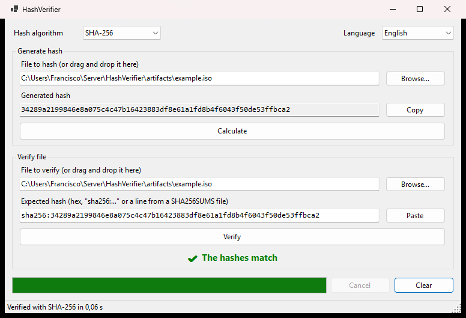

[🇪🇸 Español](docs/README-ESP.md) | [🇬🇧 English](README.md)

<p align="center"></p>

<h1 align="center">HashVerifier</h1>

[](https://github.com/FranciscoFdez05/HashVerifier/actions/workflows/ci.yml)
[](https://github.com/FranciscoFdez05/HashVerifier/releases/latest)
[](https://dotnet.microsoft.com/download/dotnet/10.0)
[](LICENSE)

HashVerifier calculates and verifies file checksums so you can confirm that a download or a copy has not been altered or corrupted. It ships as a Windows desktop app and as a command-line tool.



## ✨ Features

- **Algorithms:** MD5, SHA-1, SHA-256, SHA-384, SHA-512, and SHA3-256/384/512 (when the OS supports them).
- **Responsive with large files:** hashing runs in the background with a progress bar and a **Cancel** button.
- **Accepts whatever the publisher gives you:** a bare hash, `sha256:…`, or a line copied from a `SHA256SUMS` file (GNU `hash  file` or BSD `SHA256 (file) = hash`).
- **Detects the algorithm** from the length or prefix of the expected hash.
- **Drag and drop** files onto the window, or open a file with `HashVerifier.exe <file>`.
- **English and Spanish** interface (follows the system language; can be changed from the window).
- **Command-line tool** for scripts and CI, compatible with `sha256sum -c`.

## 📥 Download

Get the latest build from [Releases](https://github.com/FranciscoFdez05/HashVerifier/releases). The executables are self-contained, so you do not need to install .NET.

## 🖥️ Using the app

**Calculate a hash**
1. Choose a **Hash algorithm** (SHA-256 by default).
2. Select a file with **Browse…** or drag it onto the window.
3. Click **Calculate**. The hash is shown and copied to the clipboard.

**Verify a file**
1. Select the file to verify.
2. Paste the expected hash (**Paste** button). If it belongs to a different algorithm, HashVerifier switches to it automatically.
3. Click **Verify**. The result appears in green (match) or red (mismatch).

> MD5 and SHA-1 are kept for compatibility with older published checksums, but they are not collision-resistant. Prefer SHA-256 or stronger.

## ⌨️ Command line

```text
hashverifier-cli hash <file>... [-a <algorithm>]        Print the hash of each file
hashverifier-cli verify <file> <hash> [-a <algorithm>]  Compare a file with an expected hash
hashverifier-cli check <checksum-file> [-a <algorithm>] Verify every entry of a *SUMS file
hashverifier-cli algorithms                             List supported algorithms
```

```powershell
hashverifier-cli hash ubuntu.iso                       # SHA-256 by default
hashverifier-cli verify ubuntu.iso sha256:3a98…        # algorithm inferred from the hash
hashverifier-cli check SHA256SUMS                      # same as `sha256sum -c`
```

Exit codes: `0` success, `1` hash mismatch, `2` error.

## 🏗️ Building from source

Requirements: [.NET 10 SDK](https://dotnet.microsoft.com/download) and Windows (for the desktop app).

```powershell
git clone https://github.com/FranciscoFdez05/HashVerifier.git
cd HashVerifier

./scripts/build.ps1                    # restore, build and run tests
./scripts/build.ps1 -Publish           # also create single-file executables in ./artifacts
dotnet run --project src/HashVerifier.App
```

You can also open `HashVerifier.sln` in Visual Studio 2022 (17.12+) or later.

## 📁 Project structure

```text
HashVerifier/
├── src/
│   ├── HashVerifier.Core/    # Hashing and checksum parsing (cross-platform library)
│   ├── HashVerifier.App/     # Windows Forms desktop app (English/Spanish resources)
│   └── HashVerifier.Cli/     # Command-line tool
├── tests/
│   └── HashVerifier.Core.Tests/  # xUnit tests
├── scripts/build.ps1         # Build, test and publish
├── .github/workflows/ci.yml  # CI and automatic releases on v* tags
└── docs/                     # Spanish README and screenshots
```

## 🤝 Contributing

1. Fork the repository.
2. Create a branch (`git checkout -b feature/new-feature`).
3. Make sure `./scripts/build.ps1` passes.
4. Commit, push, and open a Pull Request.

## 📄 License

[GNU GPL v3](LICENSE)

---

**Developed with ❤️ by [Francisco](https://github.com/FranciscoFdez05)**
