[🇪🇸 Español](README-ESP.md) | [🇬🇧 English](../README.md)
# 🛠️ HashVerifier
HashVerifier es una aplicación de Windows Forms en C# que permite calcular y verificar hashes de archivos utilizando varios algoritmos de hash, con una interfaz intuitiva y funcional. Es ideal para verificar la integridad de archivos y asegurarse de que no han sido alterados.

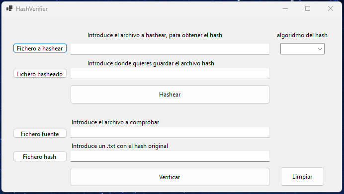

## 🚀 Descripción
HashVerifier permite calcular y verificar hashes de archivos utilizando varios algoritmos: **MD5, SHA-1, SHA-256, SHA-384** y **SHA-512**.

## ✨ Características
- 📂 Selección de archivo para calcular su hash.
- 🔍 Selección del algoritmo de hash.
- ✅ Verificar si el hash calculado coincide con un hash dado.
- 👤 Interfaz gráfica de usuario simple y fácil de usar.

## 🖥️ Requisitos
- .NET 8.0 o superior

## ⚙️ Instalación
1. Clona el repositorio:
   ```bash
   git clone https://github.com/FranciscoFdez05/HashVerifier.git
   ```
3. Navega al directorio del proyecto: `cd HashVerifier`

### Compilación en Visual Studio
1. Abre el archivo del proyecto (`HashVerifier.sln`) en Visual Studio.
2. Compila la aplicación seleccionando **Build > Build Solution**.
3. Ejecuta la aplicación desde el entorno de Visual Studio o mediante el archivo `.exe` generado en la carpeta `bin`.

### Compilación desde la línea de comandos (usando .NET CLI)
1. Asegúrate de tener .NET SDK instalado. Puedes verificarlo con: `dotnet --version`
2. En el directorio del proyecto, compila la aplicación con el siguiente comando: `dotnet build`
3. Para ejecutar la aplicación después de compilarla, usa: `dotnet run --project HashVerifier`
   O, si prefieres ejecutarla desde el archivo compilado, navega a la carpeta `bin/Debug/net472` (o `Release` si usaste la opción de compilación de release) y ejecuta el archivo `.exe` correspondiente.

### 📋 Calcular un hash 
1. Selecciona el archivo que deseas hashear utilizando el botón **"Source file"**.
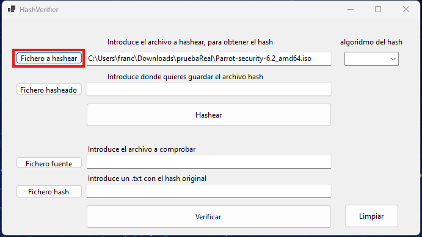

2. Selecciona el algoritmo de hash en el menú desplegable **"Hash algorithm"**.   
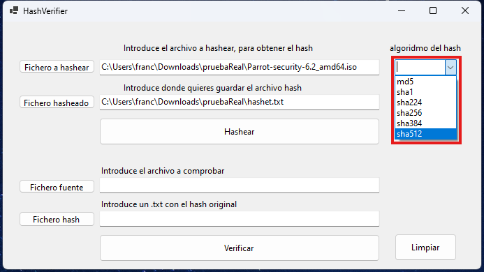
   
3. Haz clic en **"Hash"** para calcular el hash del archivo seleccionado.
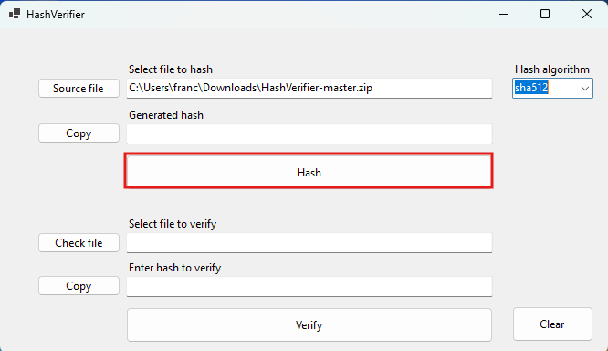

4. El hash calculado se muestra y se copia en el portapapeles
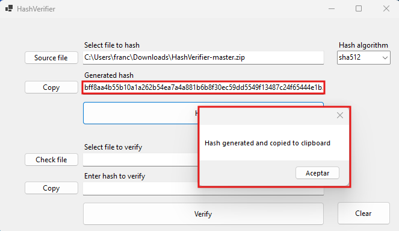

### 📋 Verificar un hash
1. Para verificar un hash, selecciona el fichero fuente (El fichero que desea calcular el hash) **"Check file"**.
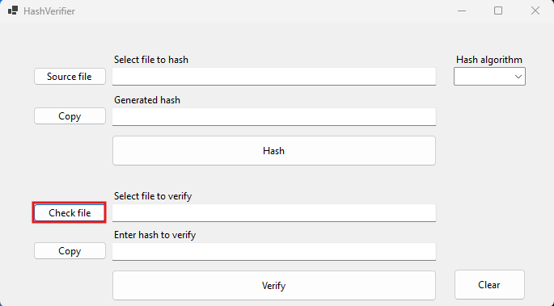 

2. Para verificar el hash, debes copiar el hash en el `text box` (dentro del rectangular rojo)
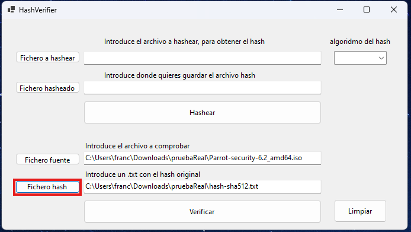 

3. Selecciona el algoritmo del hash en el menú desplegable **"Hash algorithm"**.
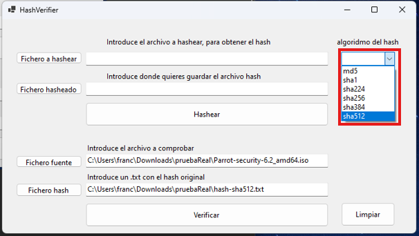

4. Para terminar la verificación debes darle a **"Verify"** y te mostrara el resultado en una ventana emergente.
- `Hash match` Significa que los hashes coinciden
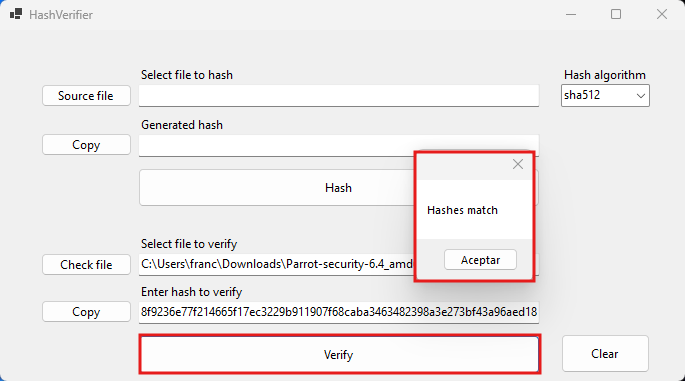
- `Error: hashes do not match` Significa q no coinciden los hashes
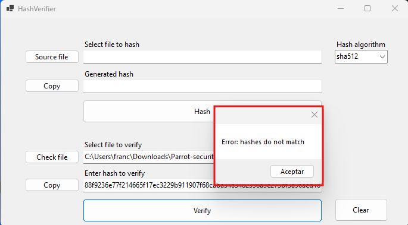

###  🗑️ Limpiar
- Para limpiar la information puedes pulsar el el botón (`clear`)
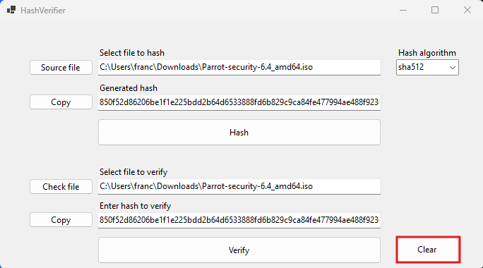
## 🤝 Contribuir
Las contribuciones son bienvenidas. Si deseas contribuir, sigue estos pasos:
1. Haz un fork del repositorio.
2. Crea una nueva rama (`git checkout -b feature/nueva-feature`).
3. Realiza los cambios necesarios y haz commit (`git commit -am 'Añadir nueva feature'`).
4. Haz push a la rama (`git push origin feature/nueva-feature`).
5. Abre un Pull Request.

---

**Developed with ❤️ by [Francisco](https://github.com/FranciscoFdez05)**
