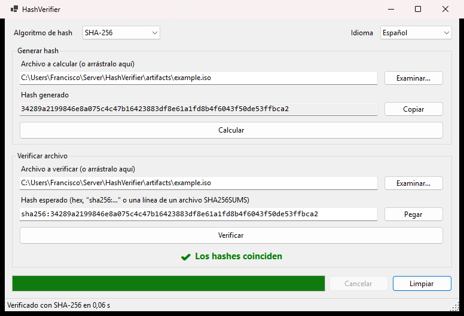

[🇪🇸 Español](README-ESP.md) | [🇬🇧 English](../README.md)

<p align="center"></p>

<h1 align="center">HashVerifier</h1>

[](https://github.com/FranciscoFdez05/HashVerifier/actions/workflows/ci.yml)
[](../LICENSE)

HashVerifier calcula y verifica checksums de archivos para confirmar que una descarga o una copia no ha sido alterada ni está corrupta. Se distribuye como aplicación de escritorio para Windows y como herramienta de línea de comandos.



## ✨ Características

- **Algoritmos:** MD5, SHA-1, SHA-256, SHA-384, SHA-512 y SHA3-256/384/512 (si el sistema operativo los admite).
- **Fluida con archivos grandes:** el cálculo se hace en segundo plano, con barra de progreso y botón **Cancelar**.
- **Acepta el formato que publique cada sitio:** un hash suelto, `sha256:…` o una línea copiada de un archivo `SHA256SUMS` (GNU `hash  archivo` o BSD `SHA256 (archivo) = hash`).
- **Detecta el algoritmo** según la longitud o el prefijo del hash esperado.
- **Arrastrar y soltar** archivos sobre la ventana, o abrir un archivo con `HashVerifier.exe <archivo>`.
- Interfaz en **español e inglés** (sigue el idioma del sistema y se puede cambiar desde la ventana).
- **Herramienta de línea de comandos** para scripts y CI, compatible con `sha256sum -c`.

## 📥 Descarga

Descarga la última versión desde [Releases](https://github.com/FranciscoFdez05/HashVerifier/releases). Los ejecutables son autocontenidos, así que no hace falta instalar .NET.

## 🖥️ Uso de la aplicación

**Calcular un hash**
1. Elige el **Algoritmo de hash** (SHA-256 por defecto).
2. Selecciona un archivo con **Examinar…** o arrástralo a la ventana.
3. Pulsa **Calcular**. El hash se muestra y se copia al portapapeles.

**Verificar un archivo**
1. Selecciona el archivo a verificar.
2. Pega el hash esperado (botón **Pegar**). Si corresponde a otro algoritmo, HashVerifier cambia a él automáticamente.
3. Pulsa **Verificar**. El resultado aparece en verde (coinciden) o en rojo (no coinciden).

> MD5 y SHA-1 se mantienen por compatibilidad con checksums antiguos, pero no son resistentes a colisiones. Usa SHA-256 o superior siempre que puedas.

## ⌨️ Línea de comandos

```text
hashverifier-cli hash <archivo>... [-a <algoritmo>]          Muestra el hash de cada archivo
hashverifier-cli verify <archivo> <hash> [-a <algoritmo>]    Compara un archivo con un hash esperado
hashverifier-cli check <archivo-checksums> [-a <algoritmo>]  Verifica cada entrada de un archivo *SUMS
hashverifier-cli algorithms                                  Lista los algoritmos disponibles
```

```powershell
hashverifier-cli hash ubuntu.iso                       # SHA-256 por defecto
hashverifier-cli verify ubuntu.iso sha256:3a98…        # algoritmo deducido del hash
hashverifier-cli check SHA256SUMS                      # equivalente a `sha256sum -c`
```

Códigos de salida: `0` correcto, `1` los hashes no coinciden, `2` error.

## 🏗️ Compilar desde el código fuente

Requisitos: [SDK de .NET 10](https://dotnet.microsoft.com/download) y Windows (para la aplicación de escritorio).

```powershell
git clone https://github.com/FranciscoFdez05/HashVerifier.git
cd HashVerifier

./scripts/build.ps1                    # restaura, compila y ejecuta las pruebas
./scripts/build.ps1 -Publish           # además genera ejecutables de un solo archivo en ./artifacts
dotnet run --project src/HashVerifier.App
```

También puedes abrir `HashVerifier.sln` en Visual Studio 2022 (17.12 o superior).

## 📁 Estructura del proyecto

```text
HashVerifier/
├── src/
│   ├── HashVerifier.Core/    # Cálculo de hashes y lectura de checksums (biblioteca multiplataforma)
│   ├── HashVerifier.App/     # Aplicación de escritorio Windows Forms (recursos en español/inglés)
│   └── HashVerifier.Cli/     # Herramienta de línea de comandos
├── tests/
│   └── HashVerifier.Core.Tests/  # Pruebas con xUnit
├── scripts/build.ps1         # Compilar, probar y publicar
├── .github/workflows/ci.yml  # CI y releases automáticas con etiquetas v*
└── docs/                     # README en español y capturas
```

## 🤝 Contribuir

1. Haz un fork del repositorio.
2. Crea una rama (`git checkout -b feature/nueva-funcionalidad`).
3. Comprueba que `./scripts/build.ps1` pasa correctamente.
4. Haz commit y push, y abre un Pull Request.

## 📄 Licencia

[GNU GPL v3](../LICENSE)

---

**Desarrollado con ❤️ por [Francisco](https://github.com/FranciscoFdez05)**
